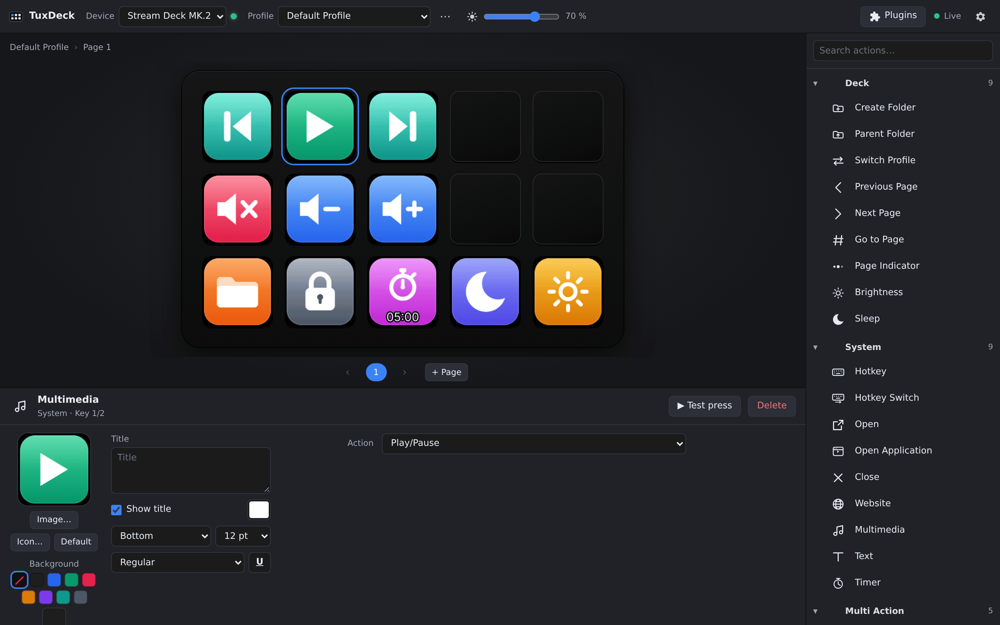
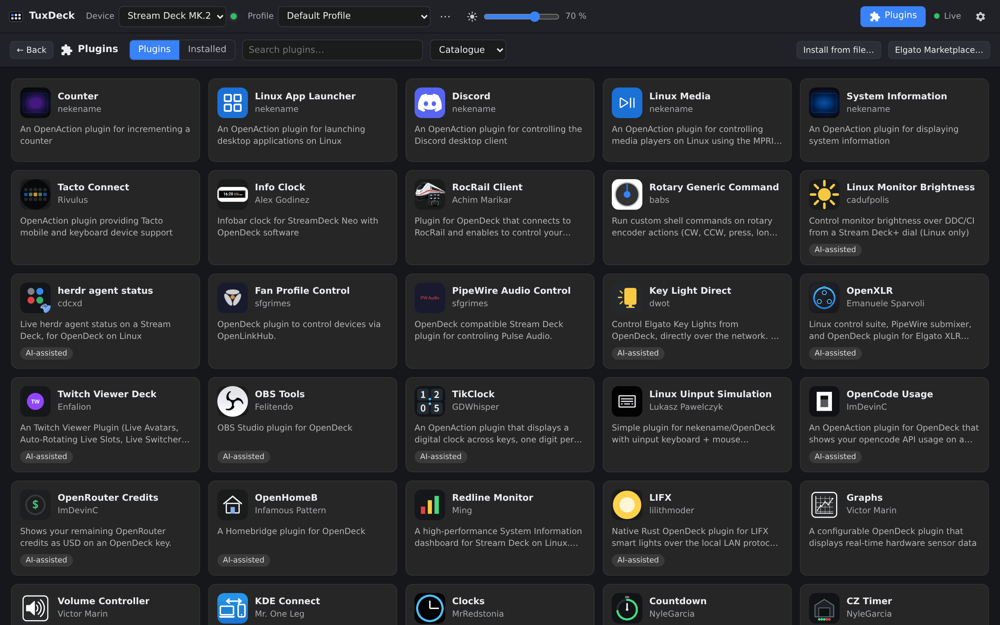
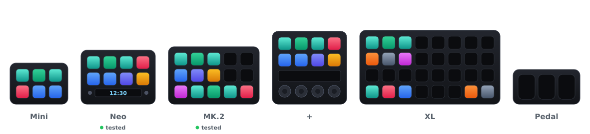

<p align="center">
  
</p>

<h1 align="center">TuxDeck</h1>

<p align="center">
  <b>Stream Deck software for Linux.</b><br>
  Your Elgato Stream Deck, its plugins and your profiles – on Ubuntu, Fedora, Arch and the rest.<br>
  No Windows, no Mac, no VM.
</p>

<p align="center">
  <a href="https://github.com/tobayashi-san/tuxdeck/releases"><b>Download</b></a>
  &nbsp;·&nbsp;
  <a href="https://tobayashi-san.github.io/tuxdeck/">Website</a>
  &nbsp;·&nbsp;
  <a href="#first-five-minutes">First five minutes</a>
  &nbsp;·&nbsp;
  <a href="#devices">Devices</a>
  &nbsp;·&nbsp;
  <a href="https://github.com/tobayashi-san/tuxdeck/blob/main/docs/README.md">Handbook</a>
</p>

<p align="center"><sub>
  <b>Beta.</b> It runs my own decks every day, but you'll find rough edges –
  <a href="https://github.com/tobayashi-san/tuxdeck/issues">tell me about them</a>.
</sub></p>

<br>



## Plug in, press keys

TuxDeck turns a Stream Deck into what it is on Windows and macOS: a row of buttons that
do exactly what you told them to.

**It feels like the official app.** Folders, pages, profiles, multi actions, hotkeys, text
snippets, a soundboard, timers. Drag an action onto a key, done.

**Your plugins keep working.** Plugins written for the Stream Deck SDK run unmodified,
settings pages included. A built-in catalogue installs open-source plugins with one click,
and anything you downloaded elsewhere installs from the file.

**Bring your setup along.** Profiles exported from the official app import as they are,
and so do its backups.

**Made for Linux, not ported to it.** Wayland and X11, GNOME, KDE, Hyprland, Sway. On
Hyprland, KDE Plasma and X11, profiles follow the window in focus. Plugins get a Linux check (test
instances, a sandbox with bubblewrap), and a badge tells you whether they work on Linux.



## Install

Grab the package for your system from **[Releases](https://github.com/tobayashi-san/tuxdeck/releases)**:

| You use | Download | Then run |
|---|---|---|
| Ubuntu, Debian, Mint, Pop!_OS | `.deb` | `sudo apt install ./tuxdeck_*_amd64.deb` |
| Fedora | `.rpm` | `sudo dnf install ./tuxdeck-*.x86_64.rpm` |
| openSUSE | `.rpm` | `sudo zypper install --allow-unsigned-rpm ./tuxdeck-*.x86_64.rpm` |
| Arch, Manjaro, anything else | `.tar.gz` | unpack it, then `./install.sh` |

Start it with your session, then unplug the Stream Deck and plug it back in:

```sh
systemctl --user enable --now tuxdeck
```

Open **TuxDeck** from your app menu. That's it.

<sub>Needs a 64-bit PC and a distribution from 2022 or newer (Ubuntu 22.04, Debian 12,
Fedora 36). Raspberry Pi, NixOS or older systems: [build from source](https://github.com/tobayashi-san/tuxdeck/blob/main/docs/README.md#build-from-source).</sub>

## First five minutes

1. **Your deck already does something.** Every device starts with a media remote laid
   out for its size; the bigger ones add a few desktop and deck keys. Press play.
2. **Make a key yours.** Drag an action from the list on the right onto a key. Its
   settings, title and icon appear underneath.
3. **Need more room?** Add a page below the deck, or drop a *Create Folder* action.
4. **Add plugins.** *Plugins*, top right. Install from the catalogue, or drop a
   `.streamDeckPlugin` file onto the window.
5. **Want a head start?** `⋯` next to the profile name → *Add a sample profile…*:
   Standard, Work, Play (Discord, games) or Streaming (OBS). They come with the app; keys
   for programs you don't have stay empty until you give them a command.
6. **Coming from Windows or macOS?** Export your profiles there and import them via the
   same `⋯` menu. TuxDeck offers to convert them for Linux once.

## Devices

<p align="center">
  
</p>

Supported: **Mini, Neo, MK.2, Stream Deck +** (dials and touch strip), **XL, Pedal**,
and the first-generation models. Not yet: Stream Deck Studio, the Stream Deck modules
and the Mini Discord edition (`tuxdeck list` names such devices as not supported). The Neo and the MK.2 are tested on
real hardware; the others are tested against simulated devices. Own one of them? A quick
report helps a lot – `tuxdeck probe` lights up every key and prints what you press, and
there's an [issue template](https://github.com/tobayashi-san/tuxdeck/issues/new?template=device.yml)
for it.

## If something's off

<details>
<summary><b>The Stream Deck isn't found</b></summary>

Unplug it and plug it back in once after installing. Still nothing? `tuxdeck list` shows
what TuxDeck can see. If you built from source, run `sudo make install-udev` first.
</details>

<details>
<summary><b>Hotkeys or text don't arrive</b></summary>

On Hyprland this works out of the box; Sway needs `wtype`, X11 `xdotool`. GNOME and KDE on
Wayland need the optional virtual keyboard – the [handbook](https://github.com/tobayashi-san/tuxdeck/blob/main/docs/README.md#troubleshooting) explains how to
switch it on and why it's off by default.
</details>

<details>
<summary><b>A plugin won't start</b></summary>

Plugins need Node.js 20 or newer (`node`), some also a Chromium-based browser. Plugins that
ship only a Windows or macOS program can't run on Linux; TuxDeck marks them.
</details>

More in the [handbook](https://github.com/tobayashi-san/tuxdeck/blob/main/docs/README.md#troubleshooting).

## Questions people ask

**Do I need an Elgato account?** No. TuxDeck doesn't sign in anywhere. Plugins from the
Elgato Marketplace website can be installed from the downloaded file – unless they're
DRM-protected, those only run in the official app.

**Is this the official app?** No, TuxDeck is an independent project written in
Rust. It is not affiliated with, endorsed or sponsored by Elgato or Corsair.

**Is it free?** Yes, and open source under the [MIT license](https://github.com/tobayashi-san/tuxdeck/blob/main/LICENSE).

<br>

---

<p align="center">
  <b>Developers, packagers, curious people:</b>
  the <a href="https://github.com/tobayashi-san/tuxdeck/blob/main/docs/README.md">handbook</a> has commands, file locations, internals and the
  release process. <a href="https://github.com/tobayashi-san/tuxdeck/blob/main/CONTRIBUTING.md">CONTRIBUTING.md</a> explains how to build and
  test without hardware.
</p>

<p align="center"><sub>
  Thanks to the <a href="https://github.com/OpenActionAPI/plugins">OpenAction plugin registry</a>
  for the catalogue and to <a href="https://github.com/abcminiuser/python-elgato-streamdeck">python-elgato-streamdeck</a>
  for documenting the older devices.<br>
  "Elgato" and "Stream Deck" are trademarks of Corsair Memory, Inc., used here only to name
  the hardware TuxDeck works with.
</sub></p>
